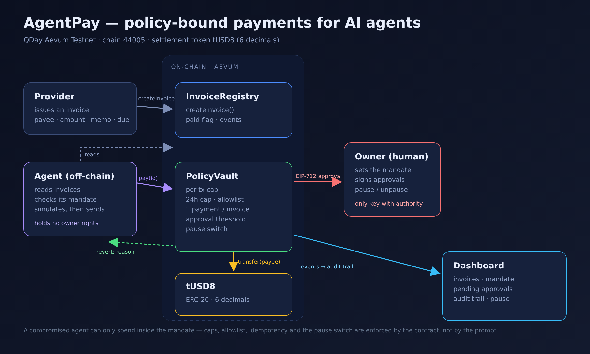
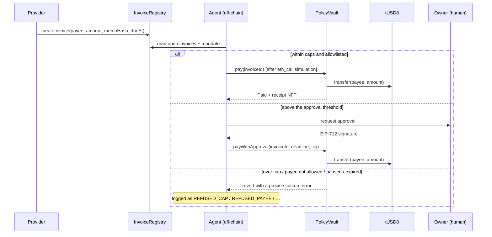
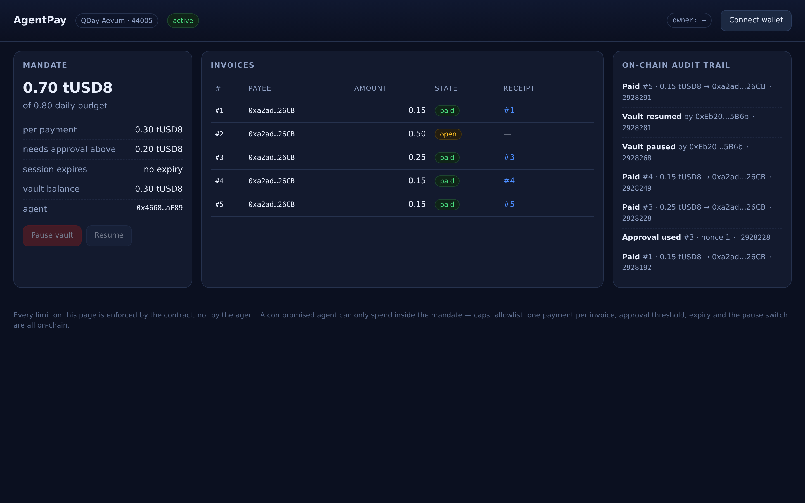

# AgentPay

**Policy-bound stablecoin payments for AI agents.**
An agent can pay invoices — but never more than its on-chain mandate allows.

Built for **Aevum Builder Challenge #1** on QDay Aevum Testnet (chain 44005), settling in **tUSD8**.
Track: **Native AI Assistants**.



---

## The problem

Agents can already decide to buy something. Giving one a funded wallet means trusting it with unbounded authority — one hallucinated amount, one prompt injection, and the money is gone.

Limits written in a prompt are not limits. They are suggestions the agent can talk itself out of.

## The idea

AgentPay puts the limit **on-chain, outside the agent**:

- A **provider** issues an invoice on-chain (payee, amount, memo hash, due date).
- An **agent** reads it, compares it against its mandate, and pays in tUSD8.
- A **policy vault** enforces caps, an allowlist, one-payment-per-invoice, an approval threshold, session expiry and a pause switch. The agent cannot raise its own limits, cannot unpause the vault, and cannot pay the same invoice twice.
- Every settlement mints an **on-chain receipt NFT** — proof that needs no trusted server.

If the agent is compromised, the blast radius is the mandate — not the balance.

## Live on Aevum Testnet

| Contract | Address |
| --- | --- |
| PolicyVault | [`0x3438513Ca98021c976D07D4584Ea6742eF2E5B22`](https://explorer-test.qday.info/address/0x3438513Ca98021c976D07D4584Ea6742eF2E5B22) |
| InvoiceRegistry | [`0x8F4Fd4Df4e77DaC2BEdA80Aa7193322D658401C8`](https://explorer-test.qday.info/address/0x8F4Fd4Df4e77DaC2BEdA80Aa7193322D658401C8) |
| PaymentReceipt (ERC-721) | [`0x4bf8b703715e8BC777e3D51D9B20d4C09c07981a`](https://explorer-test.qday.info/address/0x4bf8b703715e8BC777e3D51D9B20d4C09c07981a) |
| tUSD8 (settlement token) | [`0x456569838f1d43009A91ebA4263147Afd7233483`](https://explorer-test.qday.info/address/0x456569838f1d43009A91ebA4263147Afd7233483) |

The vault deploys its registry and receipt contract in its constructor, so one deployment is the whole system.

## How it works



Design notes: [`docs/ARCHITECTURE.md`](docs/ARCHITECTURE.md) · contract spec: [`docs/CONTRACTS.md`](docs/CONTRACTS.md) · test matrix: [`docs/TEST-PLAN.md`](docs/TEST-PLAN.md)

## Safety controls — and the test that proves each one

| Control | Enforced where | Test |
| --- | --- | --- |
| Per-transaction cap | `PolicyVault._pay` | `test_revert_perTxCap`, `testFuzz_capBoundary` |
| Rolling 24h cap | `PolicyVault._rollWindow` | `test_revert_dailyCap`, `testFuzz_neverSpendsMoreThanDailyCap` |
| Payee allowlist | owner-set mapping | `test_revert_payeeNotAllowed` |
| One payment per invoice | `InvoiceRegistry.markPaid` | `test_revert_alreadyPaid`, `testFuzz_invoicePaidAtMostOnce` |
| Human approval threshold | EIP-712 signature | `test_revert_approvalRequired`, `test_revert_badApproval_wrongSigner` |
| Approval replay protection | per-agent nonce | `test_revert_approvalReplay` |
| Session expiry | `mandate.validUntil` | `test_revert_sessionExpired` |
| Instant revocation | `revokeSession` | `test_revert_sessionRevoked` |
| Kill switch | `pause()` (owner only) | `test_revert_vaultPaused`, `test_pauseBlocksSignedApprovalToo` |
| Least privilege | agent key ≠ owner key | `test_agentCannotSetMandate`, `…Pause`, `…Withdraw`, `…AllowPayee` |
| Verifiable receipt | `PaymentReceipt` ERC-721 | `test_pay_mintsReceipt` |
| Only the vault can close an invoice | role gate | `test_onlyVaultCanMarkPaid`, `test_onlyVaultCanMintReceipt` |

`forge test` → **32 passing**, including fuzz tests over the cap boundaries and replay paths.

## Repository layout

```
src/           PolicyVault, InvoiceRegistry, PaymentReceipt (Solidity 0.8.24)
test/          32 Foundry tests, including fuzz + a 6-decimal token mock
agent/         Python agent (web3.py), owner console, provider console
web/           static dashboard (viem, no build step)
docs/          architecture, contract spec, test plan, demo script
assets/        architecture diagram, dashboard screenshot
```

## Run it

### Contracts

```bash
forge install
forge test
```

### Agent + consoles

```bash
uv venv .venv && uv pip install web3
cp .env.example .env          # RPC, addresses, three keys (agent / owner / provider)
set -a && . ./.env && set +a

python agent/provider.py --payee 0xProvider --amount 0.15 --memo "GPU rental"
python agent/run_agent.py --once          # decides and pays what the mandate allows
python agent/owner.py state               # mandate, vault balance, pause state
python agent/owner.py approve 3           # signs an EIP-712 approval for invoice #3
python agent/owner.py pause               # kill switch
```

### Dashboard

```bash
cd web && python3 -m http.server 8088
# open http://127.0.0.1:8088
```



The dashboard reads everything from chain (mandate, invoices, receipts, events) and needs no backend.
Connect an owner wallet to pause the vault or sign approvals.

## Demo (5 beats, all verified on testnet)

| # | Beat | Result on chain |
| --- | --- | --- |
| 1 | Invoice 0.15 within mandate | paid, receipt #1 minted |
| 2 | Invoice 0.50 over the 0.30 per-tx cap | refused `CAP_EXCEEDED` — invoice stays open |
| 3 | Invoice 0.25 above the 0.20 approval threshold | agent waits, owner signs EIP-712, payment lands, nonce consumed |
| 4 | Replay of invoice #1 | reverts `AlreadyPaid` |
| 5 | Vault paused, invoice arrives | refused `VAULT_PAUSED`; after resume the same invoice pays |

Full script and judge-facing checklist: [`docs/DEMO-AND-SUBMISSION.md`](docs/DEMO-AND-SUBMISSION.md)

## Assumptions and limitations

- **Single owner key.** No multisig in v1; a 2-of-3 owner is a natural next step and does not change the agent-facing surface.
- **No upgradeability.** A proxy would add an admin key that can rewrite the rules — the exact trust this design removes.
- **Testnet only.** tUSD8 has no value; nothing here moves real funds.
- **The agent's honesty is not assumed.** It is allowed to be wrong, greedy or compromised — the contract still holds. What the agent *does* control is which invoice to attempt, and that is logged.
- **Rolling window is a fixed 24h bucket**, not a sliding window. Documented in `_rollWindow`.

## Roadmap

1. Session keys via ERC-4337 so the agent is a scoped signer on a smart account, not a plain EOA.
2. Batch payroll: `payBatch(ids)` under one daily-cap accounting pass.
3. Payee categories with per-category caps (e.g. cloud providers vs contractors).
4. Webhook/event relay so a merchant backend can mark an invoice as "expected" before it is paid.

## License

MIT
